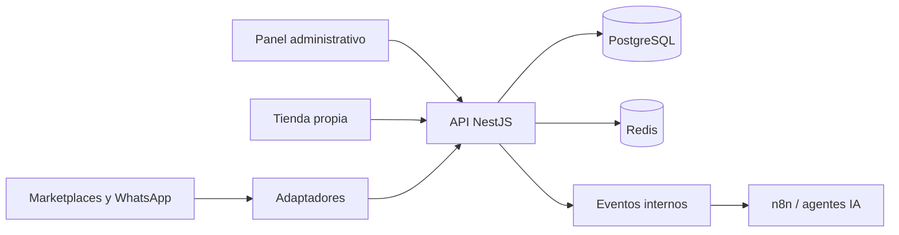
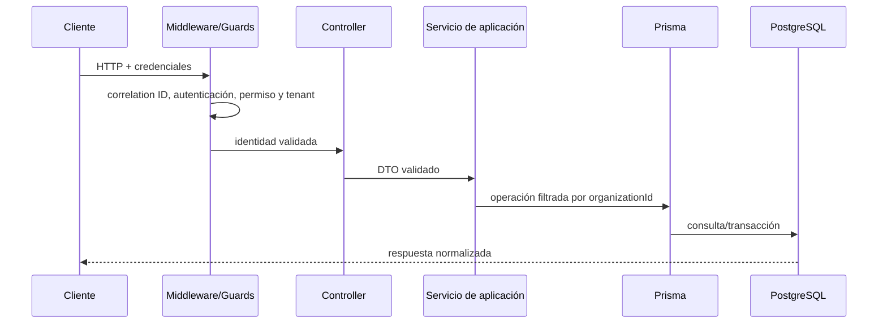

# Arquitectura

## Visión

DTodoPets Core es la fuente de verdad transaccional para ventas y operaciones.
Comienza como monolito modular NestJS para conservar transacciones simples y
límites de dominio claros sin introducir infraestructura prematura.

Las cajas distintas de API, PostgreSQL y Redis representan evolución prevista,
no componentes ya implementados.

## Estado implementado

- `AppModule` compone los módulos de infraestructura y dominio.
- `PrismaModule` es global y expone un cliente Prisma con adapter PostgreSQL.
- `OrganizationsModule` implementa CRUD básico contra `Organization`.
- `AuthModule` aplica guards globales JWT/RBAC y gestiona sesiones rotativas.
- `UsersModule` y `RolesModule` administran identidades y RBAC del tenant.
- `LocationsModule` y `WarehousesModule` modelan la estructura física.
- `CatalogModule` agrupa marcas, categorías jerárquicas, productos, variantes e
  imágenes; la creación de producto y sus dependencias es transaccional.
- `InventoryModule` mantiene saldos y reservas, y escribe un ledger inmutable.
  Usa locks de fila explícitos para serializar mutaciones concurrentes.
- `CustomersModule` mantiene identidad normalizada y direcciones; serializa los
  cambios de dirección default mediante lock del cliente.
- `OrdersModule` preserva snapshots/totales y coordina pedido, reservas, ledger
  e historial de estados dentro de transacciones con locks de fila.
- `PaymentsModule` registra cobros/reembolsos exactos e idempotentes; serializa
  el saldo neto mediante lock del pedido.
- `ReturnsModule` limita devoluciones parciales por item y reintegra stock de
  forma opcional mediante el ledger de inventario.
- `ShipmentsModule` separa fulfillment del pedido, asigna items/cobro bajo lock
  y conserva costos reales, tracking e historial de estados.
- `IntegrationsModule` mantiene canales, secretos cifrados, referencias externas,
  deduplicación de webhooks y una outbox transaccional.
- `MercadoLibreModule` es el primer adaptador: traduce IDs externos a variantes,
  reutiliza `OrdersService`, valida el origen y entrega trabajo durable a la outbox.
- `PromotionsModule` administra definiciones tenant-safe y expone el motor puro
  de precios CLP para promociones automáticas/cupones.
- `StorefrontModule` es el boundary HTTP público: selecciona únicamente datos
  publicables, protege carritos con token opaco y delega creación/reserva del
  pedido a `OrdersService` mediante hooks dentro de la misma transacción.
- `AuditModule` aplica un interceptor global a mutaciones autenticadas, persiste
  el intento antes del handler y expone una lectura paginada protegida por tenant.
- `ReportsModule` construye proyecciones de lectura tenant-safe sobre órdenes,
  pagos, clientes, inventario, carritos y promociones sin duplicar datos ni tablas.
- No existen frontend ni workers de publicación/reintento todavía.

## Límites previstos

Cada dominio mantiene controller, DTOs, servicio y pruebas. Acceso a datos pasa
por Prisma. Lógica que atraviese módulos se expone mediante servicios de
aplicación e interfaces explícitas; los controladores no coordinan reglas
transaccionales complejas.

## Flujo de una request objetivo

## Multi-tenancy

`Organization` es el límite de aislamiento. Las entidades de negocio incluirán
`organizationId` e índices/constraints compuestos cuando corresponda. El valor
se deriva del principal autenticado. Las pruebas deben demostrar que un usuario
no puede leer o mutar recursos de otro tenant.

## Autenticación y autorización

El access token JWT contiene solo IDs de usuario, organización y sesión. En cada
request el guard verifica firma/expiración y vuelve a cargar sesión, estado del
usuario/organización, roles y permisos desde PostgreSQL. Así logout,
desactivación o cambios RBAC tienen efecto sin esperar al vencimiento del JWT.
Los refresh tokens son aleatorios, se guardan hasheados y rotan atómicamente.

## Boundary público de Storefront

El slug del tenant y la key de un canal `OWN_STOREFRONT` seleccionan una tienda,
pero nunca autorizan superficies administrativas. Catálogo/promociones usan
selects públicos; un carrito requiere además su secreto bearer, del cual solo se
persiste SHA-256. El checkout toma precios e inventario autoritativos del core.

`StorefrontService` prepara cliente, dirección, promoción y bodega; luego
`OrdersService` ejecuta un solo commit que bloquea carrito/saldos y crea pedido,
items, reservas, movimiento, historial, redención y evento. El ID de carrito y
una huella canónica hacen que PostgreSQL resuelva carreras/reintentos sin doble
venta. Esto mantiene una sola regla de creación de pedidos para venta
administrativa, marketplaces y tienda propia.

## Decisiones y tradeoffs

- Monolito modular: menor costo operacional y transacciones locales; exige
  disciplina en límites internos.
- Prisma/PostgreSQL: esquema tipado y migraciones revisables; operaciones de
  concurrencia crítica requerirán transacciones y, si aplica, SQL controlado.
- Eventos internos primero: permiten adaptadores futuros sin operar Kafka antes
  de necesitarlo.

Consulta los ADR en `docs/adr/`.
