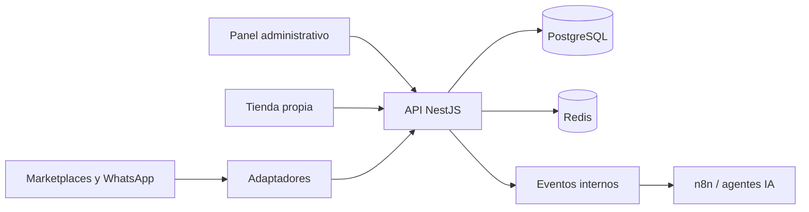
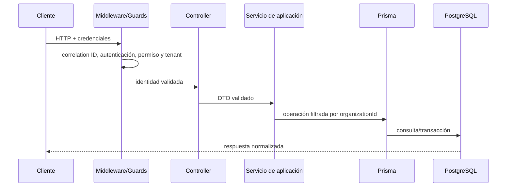

# Arquitectura

## Visión

DTodoPets Core es la fuente de verdad transaccional para ventas y operaciones.
Comienza como monolito modular NestJS para conservar transacciones simples y
límites de dominio claros sin introducir infraestructura prematura.

Las cajas distintas de API, PostgreSQL y Redis representan evolución prevista,
no componentes ya implementados.

## Estado implementado

- `AppModule` compone los módulos de infraestructura y dominio.
- `PrismaModule` es global y expone un cliente Prisma con adapter PostgreSQL.
- `OrganizationsModule` implementa CRUD básico contra `Organization`.
- `AuthModule` aplica guards globales JWT/RBAC y gestiona sesiones rotativas.
- `UsersModule` y `RolesModule` administran identidades y RBAC del tenant.
- `LocationsModule` y `WarehousesModule` modelan la estructura física.
- `CatalogModule` agrupa marcas, categorías jerárquicas, productos, variantes e
  imágenes; la creación de producto y sus dependencias es transaccional.
- No existen frontend, eventos ni adaptadores todavía.

## Límites previstos

Cada dominio mantiene controller, DTOs, servicio y pruebas. Acceso a datos pasa
por Prisma. Lógica que atraviese módulos se expone mediante servicios de
aplicación e interfaces explícitas; los controladores no coordinan reglas
transaccionales complejas.

## Flujo de una request objetivo

## Multi-tenancy

`Organization` es el límite de aislamiento. Las entidades de negocio incluirán
`organizationId` e índices/constraints compuestos cuando corresponda. El valor
se deriva del principal autenticado. Las pruebas deben demostrar que un usuario
no puede leer o mutar recursos de otro tenant.

## Autenticación y autorización

El access token JWT contiene solo IDs de usuario, organización y sesión. En cada
request el guard verifica firma/expiración y vuelve a cargar sesión, estado del
usuario/organización, roles y permisos desde PostgreSQL. Así logout,
desactivación o cambios RBAC tienen efecto sin esperar al vencimiento del JWT.
Los refresh tokens son aleatorios, se guardan hasheados y rotan atómicamente.

## Decisiones y tradeoffs

- Monolito modular: menor costo operacional y transacciones locales; exige
  disciplina en límites internos.
- Prisma/PostgreSQL: esquema tipado y migraciones revisables; operaciones de
  concurrencia crítica requerirán transacciones y, si aplica, SQL controlado.
- Eventos internos primero: permiten adaptadores futuros sin operar Kafka antes
  de necesitarlo.

Consulta los ADR en `docs/adr/`.
