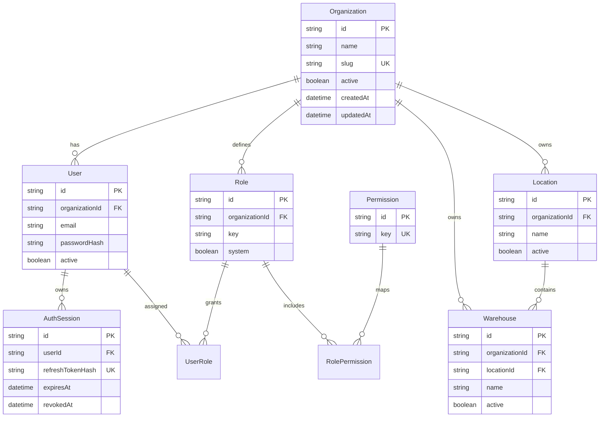

# Base de datos

## Estado real

PostgreSQL 18 contiene las tablas de Organization e Identity. Están aplicadas
`20260817231441_init_organization` y `20260822213602_add_identity_access`.

## Organization

- `id`: UUID textual generado por Prisma.
- `slug`: único global en el estado actual.
- `active`: desactivación lógica disponible para reglas futuras.
- `createdAt`/`updatedAt`: timestamps administrados por Prisma/PostgreSQL.

## Estrategia multi-tenant

Las futuras tablas de negocio llevarán `organizationId` con foreign key e
índice. Unicidades naturales como email, SKU o nombres de rol serán compuestas
con `organizationId` salvo que el dato sea global por diseño.

`User.email` y `Role.key` son únicos dentro de una organización. `Permission`
es un catálogo global; las asignaciones pasan por `RolePermission`. Las queries
administrativas incluyen `organizationId` y los guards reconstruyen permisos
desde relaciones persistidas.

## Sesiones

`AuthSession` conserva únicamente SHA-256 del refresh token opaco, expiración,
revocación y último uso. Rotar actualiza el hash mediante un `updateMany`
condicional para que dos refresh simultáneos no puedan tener éxito.

## Sucursales y bodegas

Nombres son únicos por organización. La FK compuesta de `Warehouse(locationId,
organizationId)` a `Location(id, organizationId)` impide asociar físicamente una
bodega a una sucursal de otro tenant. `locationId` puede ser nulo para bodegas
sin sucursal.

## Estrategia prevista

- Dinero CLP: `Decimal` con precisión explícita o entero en pesos, definido por
  dominio; nunca `Float`.
- Inventario: saldo por bodega/variante más ledger de movimientos auditable.
- Pedidos: items conservan snapshots comerciales y no dependen del precio actual.
- Pagos y envíos: entidades separadas del pedido.
- Integraciones: constraints de idempotencia por canal/proveedor y referencia.

Las secciones previstas no representan tablas implementadas todavía. Cada hito
actualizará este documento junto con `schema.prisma`.
