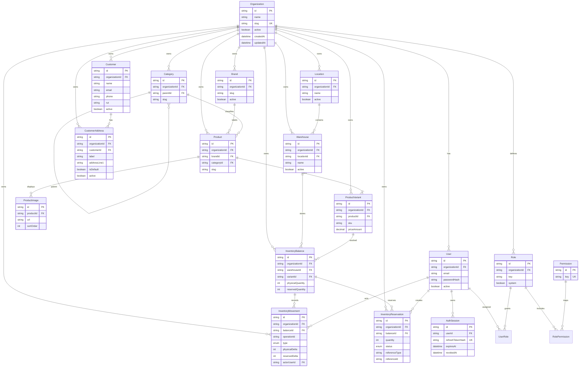

# Base de datos

## Estado real

PostgreSQL 18 contiene Foundation, Identity, Locations, Catalog, Inventory y
Customers. Hay seis migraciones aplicadas, incluida
`20260822230000_add_customers`.

## Organization

- `id`: UUID textual generado por Prisma.
- `slug`: único global en el estado actual.
- `active`: desactivación lógica disponible para reglas futuras.
- `createdAt`/`updatedAt`: timestamps administrados por Prisma/PostgreSQL.

## Estrategia multi-tenant

Las futuras tablas de negocio llevarán `organizationId` con foreign key e
índice. Unicidades naturales como email, SKU o nombres de rol serán compuestas
con `organizationId` salvo que el dato sea global por diseño.

`User.email` y `Role.key` son únicos dentro de una organización. `Permission`
es un catálogo global; las asignaciones pasan por `RolePermission`. Las queries
administrativas incluyen `organizationId` y los guards reconstruyen permisos
desde relaciones persistidas.

## Sesiones

`AuthSession` conserva únicamente SHA-256 del refresh token opaco, expiración,
revocación y último uso. Rotar actualiza el hash mediante un `updateMany`
condicional para que dos refresh simultáneos no puedan tener éxito.

## Sucursales y bodegas

Nombres son únicos por organización. La FK compuesta de `Warehouse(locationId,
organizationId)` a `Location(id, organizationId)` impide asociar físicamente una
bodega a una sucursal de otro tenant. `locationId` puede ser nulo para bodegas
sin sucursal.

## Catálogo

`Brand`, `Category`, `Product` y `ProductVariant` llevan `organizationId` e
índices compuestos. Las relaciones de producto con marca/categoría y de variante
con producto usan foreign keys compuestas con la organización, por lo que una
referencia entre tenants queda rechazada también en PostgreSQL. Las categorías
admiten jerarquía dentro del tenant; el servicio impide ciclos.

Los slugs de marca, categoría y producto, además de SKU/código de barras, son
únicos por organización. Una imagen es única por producto y URL. El borrado de
producto expuesto por la API es desactivación lógica.

Costos y precios se guardan como `Decimal(14,0)`: pesos CLP enteros, nunca
`Float`. Checks de base exigen importes no negativos, oferta no superior al
precio, peso positivo y orden de imagen no negativo.

## Inventario

`InventoryBalance` es único por organización, bodega y variante. Persiste
`physicalQuantity` y `reservedQuantity`; disponible se calcula como
`physical - reserved`. Checks de PostgreSQL garantizan cantidades no negativas y
`reserved <= physical`. FKs compuestas impiden conectar bodegas, variantes,
actores o reservas de tenants distintos.

`InventoryMovement` conserva tipo, deltas, cantidades antes/después, actor,
motivo, operación y referencia opcional. Checks verifican la aritmética y que
cada tipo use deltas válidos. Un trigger rechaza cualquier UPDATE o DELETE: el
ledger solo admite inserts.

`InventoryReservation` identifica cada reserva, su cantidad, referencia externa
opcional, creador y liberación. Una referencia es única por saldo y tenant. Los
estados `ACTIVE`/`RELEASED` están ligados por constraint a sus campos de
liberación.

Las mutaciones bloquean saldos con `SELECT ... FOR UPDATE`. Transferencias
bloquean ambos IDs ordenados y crean movimientos `TRANSFER_OUT`/`TRANSFER_IN`
con el mismo `operationId` dentro de una sola transacción.

## Clientes

`Customer` lleva `organizationId`; email, teléfono y RUT son opcionales pero,
cuando existen, únicos por tenant. La API guarda correo en minúsculas, teléfono
chileno E.164 (`+56...`) y RUT sin puntos con dígito verificador validado. Checks
de PostgreSQL refuerzan los formatos normalizados.

`CustomerAddress` conserva destinatario, contacto y dirección logística, con FK
compuesta hacia el cliente/tenant. La etiqueta es única por cliente. Un índice
parcial permite como máximo una dirección activa con `isDefault=true`; el
servicio bloquea al cliente para cambiar el default sin carreras.

## Estrategia prevista

- Dinero de los próximos dominios seguirá el patrón `Decimal(14,0)` ya aplicado
  al catálogo para pesos CLP exactos; nunca `Float`.
- Pedidos: items conservan snapshots comerciales y no dependen del precio actual.
- Pagos y envíos: entidades separadas del pedido.
- Integraciones: constraints de idempotencia por canal/proveedor y referencia.

Las secciones previstas no representan tablas implementadas todavía. Cada hito
actualizará este documento junto con `schema.prisma`.
