# Base de datos

## Estado real

PostgreSQL 18 contiene Foundation, Identity, Locations, Catalog, Inventory,
Customers, Orders, Payments, Returns, Logistics, Integrations, Mercado Libre,
Promotions, Storefront y la base persistente de Audit. Hay diecisiete migraciones
aplicadas; la última es `20260823005000_add_analytics_audit`.

```mermaid
erDiagram
  Organization ||--o{ User : has
  Organization ||--o{ Role : defines
  Organization ||--o{ Location : owns
  Organization ||--o{ Warehouse : owns
  Organization ||--o{ Brand : owns
  Organization ||--o{ Category : owns
  Organization ||--o{ Product : owns
  Organization ||--o{ ProductVariant : owns
  Organization ||--o{ InventoryBalance : owns
  Organization ||--o{ InventoryMovement : owns
  Organization ||--o{ InventoryReservation : owns
  Organization ||--o{ Customer : owns
  Organization ||--o{ CustomerAddress : owns
  Organization ||--o{ Order : owns
  Organization ||--o{ OrderItem : owns
  Organization ||--o{ OrderStatusHistory : owns
  Organization ||--o{ Payment : owns
  Organization ||--o{ PaymentRefund : owns
  Organization ||--o{ OrderReturn : owns
  Organization ||--o{ OrderReturnItem : owns
  Organization ||--o{ Shipment : owns
  Organization ||--o{ ShipmentItem : owns
  Organization ||--o{ ShipmentStatusHistory : owns
  Organization ||--o{ SalesChannel : owns
  Organization ||--o{ Integration : owns
  Organization ||--o{ ExternalReference : owns
  Organization ||--o{ WebhookReceipt : owns
  Organization ||--o{ DomainEvent : owns
  Organization ||--o{ MercadoLibreListing : owns
  Organization ||--o{ Promotion : owns
  Organization ||--o{ Cart : owns
  Organization ||--o{ PromotionRedemption : owns
  Organization ||--o{ AuditLog : records
  Location ||--o{ Warehouse : contains
  Brand ||--o{ Product : labels
  Category ||--o{ Category : parent
  Category ||--o{ Product : classifies
  Product ||--|{ ProductVariant : offers
  Product ||--o{ ProductImage : displays
  Warehouse ||--o{ InventoryBalance : stores
  ProductVariant ||--o{ InventoryBalance : stocked
  InventoryBalance ||--o{ InventoryMovement : records
  InventoryBalance ||--o{ InventoryReservation : reserves
  InventoryReservation ||--o| OrderItem : fulfills
  User ||--o{ InventoryMovement : acts
  User ||--o{ InventoryReservation : creates
  Customer ||--o{ CustomerAddress : has
  Customer ||--o{ Order : places
  CustomerAddress ||--o{ Order : ships_to
  Warehouse ||--o{ Order : fulfills
  Order ||--|{ OrderItem : contains
  Order ||--o{ OrderStatusHistory : records
  Order ||--o{ Payment : receives
  Payment ||--o{ PaymentRefund : refunds
  Order ||--o{ OrderReturn : returns
  OrderReturn ||--|{ OrderReturnItem : contains
  OrderItem ||--o{ OrderReturnItem : returned_as
  Order ||--o{ Shipment : fulfills
  Shipment ||--|{ ShipmentItem : contains
  OrderItem ||--o{ ShipmentItem : allocated_to
  Shipment ||--o{ ShipmentStatusHistory : records
  ProductVariant ||--o{ OrderItem : snapshots
  SalesChannel ||--o{ Integration : connects
  Integration ||--o{ ExternalReference : maps
  Integration ||--o{ WebhookReceipt : receives
  Integration ||--o{ DomainEvent : emits
  Integration ||--o{ MercadoLibreListing : maps
  Integration ||--o{ Order : imports
  ProductVariant ||--o{ MercadoLibreListing : publishes
  SalesChannel ||--o{ Promotion : scopes
  SalesChannel ||--o{ Cart : receives
  Promotion ||--o{ PromotionVariant : targets
  ProductVariant ||--o{ PromotionVariant : eligible
  Cart ||--o{ CartItem : contains
  ProductVariant ||--o{ CartItem : selected
  Cart ||--o| Order : checks_out_as
  Promotion ||--o{ PromotionRedemption : redeems
  Order ||--o{ PromotionRedemption : records
  User ||--o{ AuditLog : acts
  User ||--o{ AuthSession : owns
  User ||--o{ UserRole : assigned
  Role ||--o{ UserRole : grants
  Role ||--o{ RolePermission : includes
  Permission ||--o{ RolePermission : maps
  Organization {
    string id PK
    string name
    string slug UK
    boolean active
    datetime createdAt
    datetime updatedAt
  }
  User {
    string id PK
    string organizationId FK
    string email
    string passwordHash
    boolean active
  }
  Role {
    string id PK
    string organizationId FK
    string key
    boolean system
  }
  Permission {
    string id PK
    string key UK
  }
  AuthSession {
    string id PK
    string userId FK
    string refreshTokenHash UK
    datetime expiresAt
    datetime revokedAt
  }
  Location {
    string id PK
    string organizationId FK
    string name
    boolean active
  }
  Warehouse {
    string id PK
    string organizationId FK
    string locationId FK
    string name
    boolean active
  }
  Brand {
    string id PK
    string organizationId FK
    string slug
    boolean active
  }
  Category {
    string id PK
    string organizationId FK
    string parentId FK
    string slug
  }
  Product {
    string id PK
    string organizationId FK
    string brandId FK
    string categoryId FK
    string slug
  }
  ProductVariant {
    string id PK
    string organizationId FK
    string productId FK
    string sku
    decimal priceAmount
  }
  ProductImage {
    string id PK
    string productId FK
    string url
    int sortOrder
  }
  InventoryBalance {
    string id PK
    string organizationId FK
    string warehouseId FK
    string variantId FK
    int physicalQuantity
    int reservedQuantity
  }
  InventoryMovement {
    string id PK
    string organizationId FK
    string balanceId FK
    string operationId
    enum type
    int physicalDelta
    int reservedDelta
    string actorUserId FK
  }
  InventoryReservation {
    string id PK
    string organizationId FK
    string balanceId FK
    int quantity
    enum status
    string referenceType
    string referenceId
  }
  Customer {
    string id PK
    string organizationId FK
    string name
    string email
    string phone
    string rut
    boolean active
  }
  CustomerAddress {
    string id PK
    string organizationId FK
    string customerId FK
    string label
    string addressLine1
    boolean isDefault
    boolean active
  }
  Order {
    string id PK
    string organizationId FK
    string number
    string customerId FK
    string warehouseId FK
    enum status
    decimal totalAmount
    json customerSnapshot
    json shippingSnapshot
    string sourceIntegrationId FK
    string externalOrderId
    string sourceRequestHash
    string storefrontCartId FK
  }
  OrderItem {
    string id PK
    string organizationId FK
    string orderId FK
    string variantId FK
    string skuSnapshot
    decimal unitPriceAmount
    int quantity
    decimal totalAmount
  }
  OrderStatusHistory {
    string id PK
    string organizationId FK
    string orderId FK
    enum status
    string reason
    string actorUserId FK
  }
  Payment {
    string id PK
    string organizationId FK
    string orderId FK
    enum method
    enum status
    decimal amount
    string provider
    string idempotencyKey
    string requestHash
  }
  PaymentRefund {
    string id PK
    string organizationId FK
    string paymentId FK
    decimal amount
    string reason
    string idempotencyKey
    string requestHash
  }
  OrderReturn {
    string id PK
    string organizationId FK
    string orderId FK
    string number
    string reason
    string idempotencyKey
    string requestHash
  }
  OrderReturnItem {
    string id PK
    string organizationId FK
    string orderReturnId FK
    string orderItemId FK
    int quantity
    boolean restocked
  }
  Shipment {
    string id PK
    string organizationId FK
    string orderId FK
    string number
    enum type
    enum status
    decimal customerChargeAmount
    decimal actualCostAmount
    string trackingNumber
    string idempotencyKey
  }
  ShipmentItem {
    string id PK
    string organizationId FK
    string shipmentId FK
    string orderItemId FK
    int quantity
  }
  ShipmentStatusHistory {
    string id PK
    string organizationId FK
    string shipmentId FK
    enum status
    string reason
    string trackingNumber
    decimal actualCostAmount
    string actorUserId FK
  }
  SalesChannel {
    string id PK
    string organizationId FK
    string key
    enum type
    boolean active
  }
  Integration {
    string id PK
    string organizationId FK
    string salesChannelId FK
    string key
    string provider
    string credentialsCiphertext
  }
  ExternalReference {
    string id PK
    string integrationId FK
    enum entityType
    string entityId
    string externalId
  }
  WebhookReceipt {
    string id PK
    string integrationId FK
    string externalEventId
    string payloadHash
    enum status
  }
  DomainEvent {
    string id PK
    string integrationId FK
    string aggregateType
    string type
    enum status
  }
  MercadoLibreListing {
    string id PK
    string integrationId FK
    string variantId FK
    string externalItemId
    string externalVariationId
    decimal listingPriceAmount
    decimal feeAmount
    int availableQuantity
  }
  Promotion {
    string id PK
    string organizationId FK
    string salesChannelId FK
    string code
    boolean automatic
    enum type
    enum scope
    int value
    decimal minimumSubtotalAmount
    decimal maximumDiscountAmount
  }
  PromotionVariant {
    string id PK
    string promotionId FK
    string variantId FK
  }
  Cart {
    string id PK
    string organizationId FK
    string salesChannelId FK
    string promotionId FK
    enum status
    string accessTokenHash UK
    string checkoutRequestHash
    int version
    datetime expiresAt
  }
  CartItem {
    string id PK
    string cartId FK
    string variantId FK
    int quantity
  }
  PromotionRedemption {
    string id PK
    string promotionId FK
    string orderId FK
    string customerId FK
    decimal discountAmount
    string nameSnapshot
  }
  AuditLog {
    string id PK
    string organizationId FK
    string actorUserId FK
    enum outcome
    string method
    string action
    string resourceType
    string resourceId
    string correlationId
    int httpStatus
    int durationMs
  }
```

## Organization

- `id`: UUID textual generado por Prisma.
- `slug`: único global en el estado actual.
- `active`: desactivación lógica disponible para reglas futuras.
- `createdAt`/`updatedAt`: timestamps administrados por Prisma/PostgreSQL.

## Estrategia multi-tenant

Las futuras tablas de negocio llevarán `organizationId` con foreign key e
índice. Unicidades naturales como email, SKU o nombres de rol serán compuestas
con `organizationId` salvo que el dato sea global por diseño.

`User.email` y `Role.key` son únicos dentro de una organización. `Permission`
es un catálogo global; las asignaciones pasan por `RolePermission`. Las queries
administrativas incluyen `organizationId` y los guards reconstruyen permisos
desde relaciones persistidas.

## Sesiones

`AuthSession` conserva únicamente SHA-256 del refresh token opaco, expiración,
revocación y último uso. Rotar actualiza el hash mediante un `updateMany`
condicional para que dos refresh simultáneos no puedan tener éxito.

## Sucursales y bodegas

Nombres son únicos por organización. La FK compuesta de `Warehouse(locationId,
organizationId)` a `Location(id, organizationId)` impide asociar físicamente una
bodega a una sucursal de otro tenant. `locationId` puede ser nulo para bodegas
sin sucursal.

## Catálogo

`Brand`, `Category`, `Product` y `ProductVariant` llevan `organizationId` e
índices compuestos. Las relaciones de producto con marca/categoría y de variante
con producto usan foreign keys compuestas con la organización, por lo que una
referencia entre tenants queda rechazada también en PostgreSQL. Las categorías
admiten jerarquía dentro del tenant; el servicio impide ciclos.

Los slugs de marca, categoría y producto, además de SKU/código de barras, son
únicos por organización. Una imagen es única por producto y URL. El borrado de
producto expuesto por la API es desactivación lógica.

Costos y precios se guardan como `Decimal(14,0)`: pesos CLP enteros, nunca
`Float`. Checks de base exigen importes no negativos, oferta no superior al
precio, peso positivo y orden de imagen no negativo.

## Inventario

`InventoryBalance` es único por organización, bodega y variante. Persiste
`physicalQuantity` y `reservedQuantity`; disponible se calcula como
`physical - reserved`. Checks de PostgreSQL garantizan cantidades no negativas y
`reserved <= physical`. FKs compuestas impiden conectar bodegas, variantes,
actores o reservas de tenants distintos.

`InventoryMovement` conserva tipo, deltas, cantidades antes/después, actor,
motivo, operación y referencia opcional. Checks verifican la aritmética y que
cada tipo use deltas válidos. Un trigger rechaza cualquier UPDATE o DELETE: el
ledger solo admite inserts. `RETURN` aumenta únicamente físico y deja reservado
intacto cuando una devolución decide reintegrar mercadería.

`InventoryReservation` identifica cada reserva, su cantidad, referencia externa
opcional, creador y cierre. Una referencia es única por saldo y tenant. Los
estados `ACTIVE`/`RELEASED`/`CONSUMED` están ligados por constraints a sus
campos de liberación o consumo. Confirmar un pedido crea un movimiento `COMMIT`
que reduce físico y reservado en la misma cantidad.

Las mutaciones bloquean saldos con `SELECT ... FOR UPDATE`. Transferencias
bloquean ambos IDs ordenados y crean movimientos `TRANSFER_OUT`/`TRANSFER_IN`
con el mismo `operationId` dentro de una sola transacción.

## Clientes

`Customer` lleva `organizationId`; email, teléfono y RUT son opcionales pero,
cuando existen, únicos por tenant. La API guarda correo en minúsculas, teléfono
chileno E.164 (`+56...`) y RUT sin puntos con dígito verificador validado. Checks
de PostgreSQL refuerzan los formatos normalizados.

`CustomerAddress` conserva destinatario, contacto y dirección logística, con FK
compuesta hacia el cliente/tenant. La etiqueta es única por cliente. Un índice
parcial permite como máximo una dirección activa con `isDefault=true`; el
servicio bloquea al cliente para cambiar el default sin carreras.

## Pedidos

`Order` es único por número y organización, referencia cliente, dirección y
bodega del mismo tenant mediante FKs compuestas, y conserva snapshots JSON de
cliente/despacho. Estados disponibles: `PENDING`, `CONFIRMED`, `CANCELLED` y
`COMPLETED`. Checks exigen moneda CLP, importes no negativos, total igual a
subtotal menos descuento más envío y timestamps coherentes con el estado.

`OrderItem` conserva SKU, nombre, precio unitario, cantidad, descuentos y
totales históricos. Cada variante aparece una vez por pedido y su subtotal debe
ser exactamente precio por cantidad. La reserva de inventario asociada queda
únicamente ligada a ese item.

`OrderStatusHistory` registra estado, motivo, actor y fecha sin exponer una ruta
de actualización. Creación, cambio de estado, reservas y movimientos ocurren en
la misma transacción.

Una orden externa conserva `sourceIntegrationId`, `externalOrderId` y
`sourceRequestHash` como un contrato indivisible. La pareja integración/ID es
única y la huella debe ser SHA-256 hexadecimal; así la base resuelve carreras de
importación sin duplicar pedido ni reserva. La huella es interna y se omite de
las respuestas.

## Pagos y reembolsos

`Payment` referencia un pedido del mismo tenant y conserva método, estado,
importe `Decimal(14,0)`, proveedor, referencia externa, actor y timestamps. Moneda
queda restringida a CLP e importe debe ser positivo. La combinación
organización/proveedor/referencia externa evita duplicar una captura conocida.

Cada pago tiene una clave idempotente única por organización y una huella
SHA-256 canónica del request. `PaymentRefund` aplica el mismo patrón, es
append-only desde la API y conserva importe, motivo y actor. El servicio bloquea
primero pedido y pago para limitar el reembolso acumulado y derivar
`CAPTURED`/`PARTIALLY_REFUNDED`/`REFUNDED` sin carreras.

## Devoluciones

`OrderReturn` registra número, pedido, motivo, actor y contrato idempotente.
`OrderReturnItem` enlaza el item comprado, cantidad y decisión de reintegro. La
cantidad es positiva; el servicio bloquea el pedido y suma devoluciones previas
para impedir exceder lo comprado.

Cuando `restocked=true`, se bloquea el `InventoryBalance` original asociado a la
reserva consumida, se aumenta físico y se inserta un movimiento `RETURN` en la
misma transacción. La devolución comercial y el reembolso permanecen separados.

## Logistics

`Shipment` referencia un pedido/tenant y conserva tipo, estado, cobro asignado,
costo real, carrier/servicio, tracking, notas, timestamps e idempotencia. Tipos:
`PICKUP`, `OWN_DELIVERY`, `MARKETPLACE`, `EXTERNAL_COURIER`; estados:
`PENDING`, `READY`, `IN_TRANSIT`, `DELIVERED`, `CANCELLED`.

Checks exigen moneda CLP, importes no negativos, costo real al entregar,
metadatos coherentes con retiro/courier y timestamps compatibles con el estado.
El tracking es único por organización/carrier cuando existe. La huella interna
es SHA-256 y la clave idempotente es única por tenant.

`ShipmentItem` asigna cantidades de `OrderItem`; el servicio bloquea el pedido y
suma asignaciones no canceladas para permitir fulfillment parcial sin exceso.
Aplica el mismo lock al cobro logístico: su suma activa no supera lo cobrado en
el pedido. `ShipmentStatusHistory` guarda estado, motivo, actor y snapshots de
tracking/costo real en cada transición.

## Canales e integraciones

`SalesChannel` define el origen comercial; `Integration` separa configuración
JSON pública de `credentialsCiphertext` AES-256-GCM. Ambas claves son únicas por
tenant y las FKs compuestas impiden asociaciones cruzadas.

`ExternalReference` garantiza mappings bidireccionales únicos por integración y
tipo. `WebhookReceipt` conserva payload, huella SHA-256, estado e intentos con
unicidad por evento externo. `DomainEvent` es la outbox durable con estado,
intentos, disponibilidad y publicación; se inserta junto con la mutación.

## Mercado Libre

`MercadoLibreListing` relaciona una integración `provider=mercado-libre` con
una variante del mismo tenant. Mantiene item/variación externos, estado,
disponibilidad, metadata, última sincronización y snapshots opcionales de precio
y comisión `Decimal(14,0)` en CLP. Unicidades separadas impiden mapear dos veces
la misma variante o el mismo par externo dentro de una integración.

Las FKs compuestas refuerzan que integración, organización y variante pertenezcan
al mismo tenant. Checks prohíben IDs en blanco, cantidades/importes negativos y
otra moneda. La importación crea `ExternalReference(ORDER)` y un `DomainEvent`
durable; el webhook crea recibo/evento atómicamente.

## Promotions y Storefront

`Promotion` conserva tipo, alcance, valor, vigencia, prioridad, mínimo/tope CLP,
modo automático/cupón y canal propio opcional. `PromotionVariant` materializa el
alcance selectivo. Unicidades y FKs compuestas impiden códigos duplicados o
variantes/canales cruzados; checks validan modo, porcentaje, importes y fechas.

`Cart` pertenece a un `SalesChannel`, guarda solo `accessTokenHash`, versión,
estado, expiración y la huella de checkout una vez finalizado. `CartItem` exige
cantidad positiva y variante del mismo tenant. Los checks distinguen estados
`ACTIVE`, `CHECKED_OUT`, `ABANDONED` y `EXPIRED`; un activo no tiene cliente ni
huella y uno finalizado exige cliente, huella SHA-256 y timestamp.

`Order.storefrontCartId` es único por organización y mutuamente excluyente con
el origen integración/ID externo. `PromotionRedemption` enlaza promoción,
cliente y orden del mismo tenant y congela nombre, código, tipo, valor, moneda y
descuento. Pedido, reserva, redención y cierre se confirman en una transacción;
la base evita que dos carreras creen dos órdenes para un carrito.

## Audit (checkpoint parcial)

`AuditLog` ya persiste tenant, actor, sesión, outcome, método, acción/ruta,
recurso, correlation ID, IP directa y resultado temporal/HTTP sin columna para
body o secretos. El ciclo parte en `ATTEMPTED` y puede finalizar una sola vez en
`SUCCEEDED` o `FAILED`; constraints validan los campos de cada estado y un
trigger bloquea DELETE, cambios de identidad y nuevas modificaciones terminales.

La tabla e índices están aplicados, pero este checkpoint no incorpora todavía
servicio, interceptor/captura ni endpoint de lectura. Por tanto la tabla local
permanece vacía hasta continuar la Fase 12.

## Estrategia prevista

- Dinero de los próximos dominios seguirá el patrón `Decimal(14,0)` aplicado a
  catálogo, pedidos y promociones para pesos CLP exactos; nunca `Float`.
- Nuevos adaptadores reutilizarán referencias, recibos y outbox existentes.

Las secciones previstas no representan tablas implementadas todavía. Cada hito
actualizará este documento junto con `schema.prisma`.
